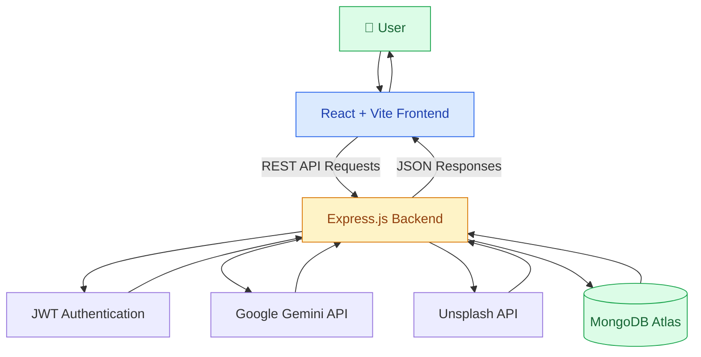
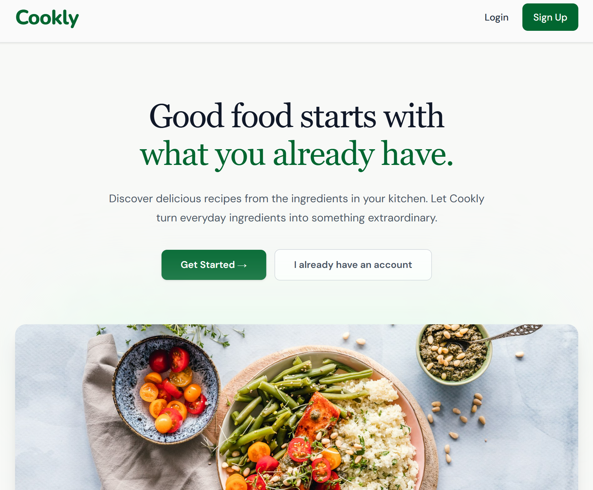
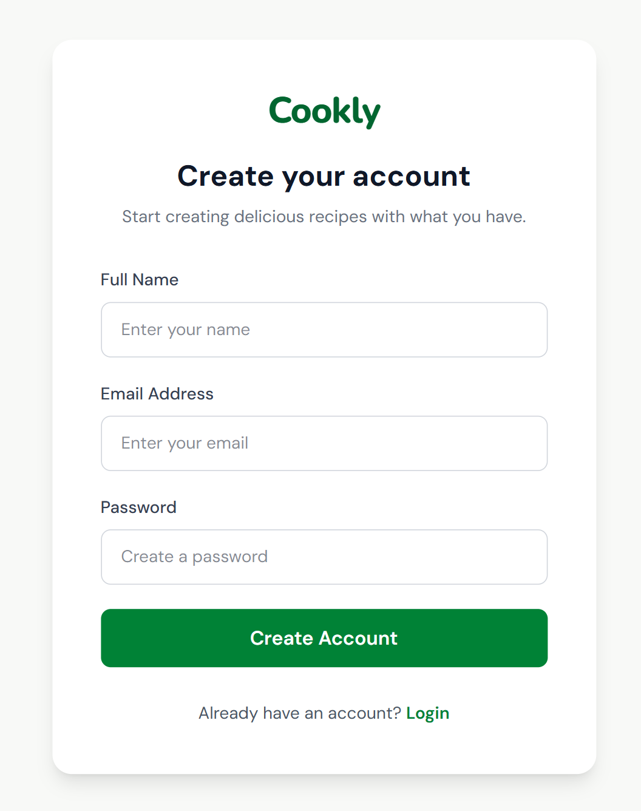
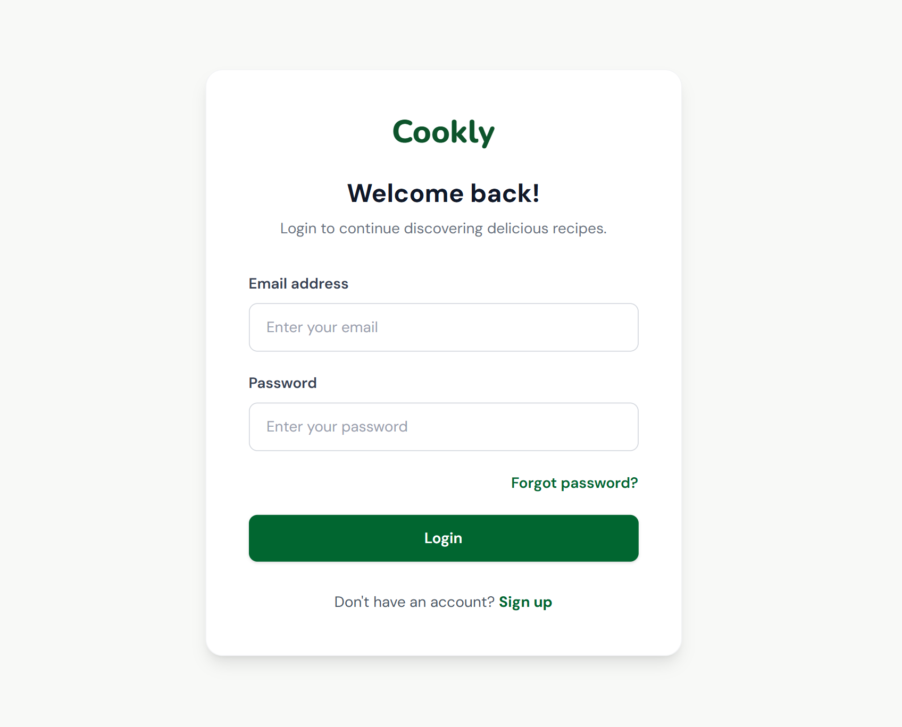
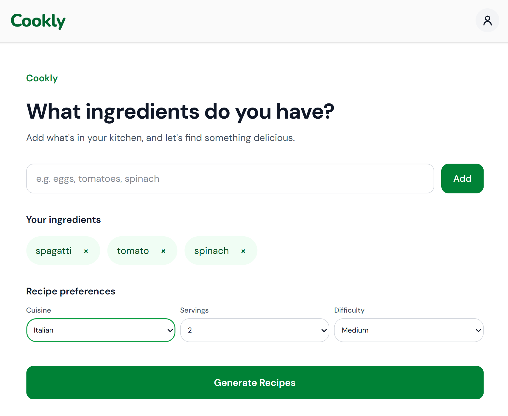
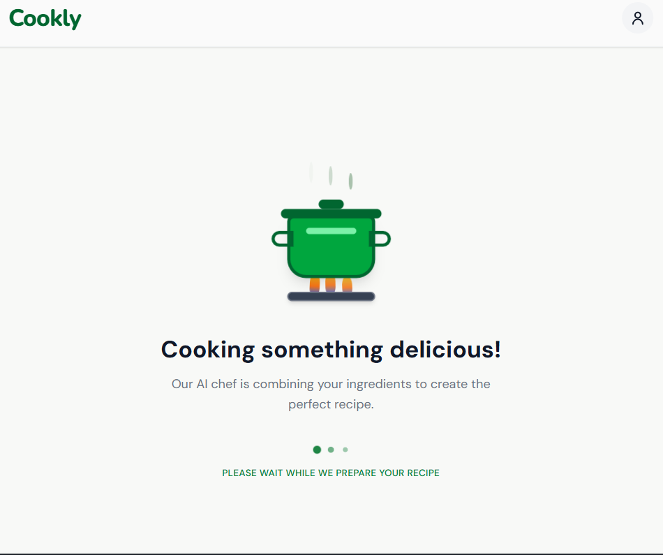
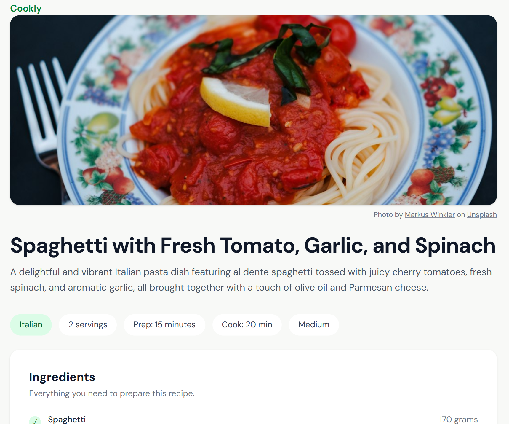
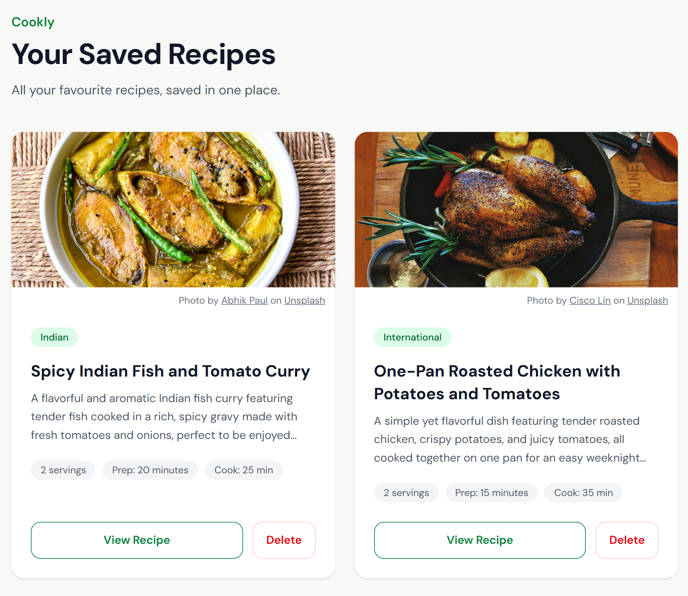

# 🍳 Cookly

### Your Ingredients. Your Kitchen. Your AI Chef.

<p align="center">
  <strong>Turn everyday ingredients into extraordinary recipes with AI.</strong>
</p>

<p align="center">
  <a href="https://cookly-two.vercel.app/">
    
  </a>
  
  
</p>

---

## 📖 Overview

**Cookly** is an AI-powered recipe generation platform that transforms the ingredients you already have into personalized cooking experiences.

Simply enter the ingredients available in your kitchen, customize your cooking preferences, and let Google's Gemini AI generate recipes tailored to your choices.

Whether you're looking for a quick meal or exploring something new, Cookly helps you discover what you can create with what's already in your kitchen.

### 💡 The Idea

Why search for recipes based on what you need to buy when you can discover recipes based on what you already have?

Cookly reverses the traditional recipe discovery process:

`Your Ingredients` → `AI Processing` → `Personalized Recipes` → `Your Next Meal`

---


## ✨ Key Features

Cookly combines AI-powered recipe generation with a simple and intuitive cooking experience.

### 🥕 AI Recipe Generation
- Generate personalized recipes based on available ingredients.
- Powered by Google's Gemini AI.
- Get structured recipes with ingredients, quantities and cooking instructions.

### ⚙️ Customizable Cooking Preferences
- Choose your preferred cuisine.
- Select cooking difficulty: Easy, Medium or Hard.
- Customize the number of servings.
- Add and remove ingredients before generating recipes.

### 🖼️ Recipe Photography
- Automatically fetch relevant food images using the Unsplash API.
- Display recipe images alongside generated recipes.
- Include photographer attribution and image source links.

### 👤 User Authentication
- Secure user registration and login.
- Password hashing for secure credential storage.
- JWT-based authentication.
- Protected routes for authenticated users.

### 📚 Personal Recipe Collection
- Save generated recipes for later.
- Browse previously saved recipes.
- View complete recipe details.
- Delete recipes from your collection.

### ⏳ Interactive User Experience
- Animated loading screen during recipe generation.
- Responsive interface for desktop and mobile devices.
- Clear feedback for loading, errors and empty states.

---


## 🏗️ System Architecture

Cookly follows a client-server architecture where the React frontend communicates with the Express backend through REST APIs.

### 🔄 Application Workflow

1. **User Interaction:** Users enter available ingredients and select their cooking preferences through the React frontend.
2. **API Communication:** The frontend sends the recipe generation request to the Express backend using Axios.
3. **AI Processing:** The backend communicates with Google's Gemini API to generate a structured recipe.
4. **Image Retrieval:** The backend uses the Unsplash API to retrieve a relevant food image.
5. **Recipe Delivery:** The generated recipe and image metadata are returned to the frontend.
6. **Recipe Persistence:** When a user saves a recipe, the backend stores it in MongoDB Atlas.
7. **Recipe Management:** Authenticated users can retrieve and delete their saved recipes.

### 🧩 High-Level Architecture



### 🌐 Deployment Architecture

| Component | Platform |
|---|---|
| Frontend | Vercel |
| Backend REST API | Render |
| Database | MongoDB Atlas |
| AI Recipe Generation | Google Gemini |
| Food Images | Unsplash |

---


## 📸 Application Screenshots

Explore the Cookly interface and its core application workflows.

### 🏠 Landing Page


### 🔐 Authentication

| Sign Up | Login |
|---|---|
|  |  |

### 🥕 Ingredient Selection


### 🍳 Recipe Generation


### 🍽️ Generated Recipe


### 📚 Saved Recipes


---


## 📁 Project Structure

Cookly follows a modular project structure, separating frontend components, backend services, API routes, database models and application logic.

```text
cookly/
│
├── client/                         # React frontend
│   ├── public/
│   ├── src/
│   │   ├── api/                    # API service and Axios configuration
│   │   │   ├── client.js
│   │   │   ├── authService.js
│   │   │   └── recipeService.js
│   │   │
│   │   ├── components/             # Reusable UI components
│   │   │   ├── Navbar.jsx
│   │   │   └── ProtectedRoute.jsx
│   │   │
│   │   ├── context/                # Global application state
│   │   │   └── AuthContext.jsx
│   │   │
│   │   ├── pages/                  # Application pages
│   │   │   ├── HomePage.jsx
│   │   │   ├── LoginPage.jsx
│   │   │   ├── RegisterPage.jsx
│   │   │   ├── IngredientsPage.jsx
│   │   │   ├── LoadingPage.jsx
│   │   │   ├── RecipeResultsPage.jsx
│   │   │   └── SavedRecipesPage.jsx
│   │   │
│   │   ├── App.jsx
│   │   ├── main.jsx
│   │   └── index.css
│   │
│   ├── .env.local
│   ├── vercel.json
│   └── package.json
│
├── server/                          # Express backend
│   ├── src/
│   │   ├── config/                  # Database configuration
│   │   ├── controllers/             # Request controllers
│   │   ├── middleware/              # Authentication and validation
│   │   ├── models/                  # Mongoose schemas
│   │   ├── routes/                  # API route definitions
│   │   ├── services/                # Business logic and integrations
│   │   ├── utils/                   # Utility functions
│   │   ├── validators/              # Request validation
│   │   └── app.js
│   │
│   ├── .env
│   ├── .env.example
│   ├── package.json
│   └── server.js
│
├── screenshots/                     # Application screenshots
│
└── README.md
```

### 📌 Code Organization

| Directory | Responsibility |
|---|---|
| `client/src/pages` | Application screens and page-level components |
| `client/src/components` | Reusable frontend components |
| `client/src/context` | Shared authentication state |
| `client/src/api` | Frontend API communication |
| `server/src/config` | Database and application configuration |
| `server/src/controllers` | Handles incoming API requests |
| `server/src/models` | MongoDB data models |
| `server/src/routes` | Defines backend API endpoints |
| `server/src/services` | Application business logic and external API integrations |
| `server/src/middleware` | Authentication, error handling and request validation |

---


## ⚙️ Installation & Setup

Follow these steps to set up Cookly on your local machine.

### 📋 Prerequisites

Make sure you have the following installed:

- [Node.js](https://nodejs.org/) (LTS recommended)
- npm (included with Node.js)
- [Git](https://git-scm.com/)
- [MongoDB Atlas](https://www.mongodb.com/atlas) account or a local MongoDB instance
- Google Gemini API key
- Unsplash API access key

### 1. Clone the Repository

```bash
git clone https://github.com/VishnuVardhanKasireddy/cookly.git

cd cookly
```

### 2. Configure the Backend

Navigate to the server directory:

```bash
cd server
```

Install the dependencies:

```bash
npm install
```

Create a `.env` file inside the `server` directory:

```env
PORT=8000
NODE_ENV=development

MONGO_URI=your_mongodb_connection_string
JWT_SECRET=your_jwt_secret

GEMINI_API_KEY=your_gemini_api_key
UNSPLASH_ACCESS_KEY=your_unsplash_access_key
```

Replace the placeholder values with your actual credentials.

Start the backend server:

```bash
npm start
```

The backend should now be running at:

```text
http://localhost:8000
```

### 3. Configure the Frontend

Open a new terminal and navigate to the client directory:

```bash
cd client
```

Install the dependencies:

```bash
npm install
```

Create a `.env.local` file inside the `client` directory:

```env
VITE_API_BASE_URL=http://localhost:8000/api
```

Start the frontend development server:

```bash
npm run dev
```

The frontend will be available at:

```text
http://localhost:5173
```

### 4. Access the Application

Once both servers are running, open the frontend URL in your browser:

**http://localhost:5173**

You can now register an account, generate recipes and manage your saved recipes.

### 🔐 Environment Variables

| Variable | Description |
|---|---|
| `PORT` | Backend server port |
| `NODE_ENV` | Application environment |
| `MONGO_URI` | MongoDB connection string |
| `JWT_SECRET` | Secret used for JWT authentication |
| `GEMINI_API_KEY` | Google Gemini API key |
| `UNSPLASH_ACCESS_KEY` | Unsplash API access key |
| `VITE_API_BASE_URL` | Backend API base URL used by the frontend |

> **Security Note:** Never commit `.env` or `.env.local` files to GitHub. Keep API keys, database credentials and JWT secrets private.

---


## 🔌 API Documentation

Cookly provides RESTful APIs for user authentication and recipe management.

### 🌐 Base URL

**Local Development**
```text
http://localhost:8000/api
```

**Production**
```text
https://cookly-api-vrhw.onrender.com/api
```

### 🔐 Authentication APIs

| Method | Endpoint | Description | Access |
|---|---|---|---|
| POST | `/auth/register` | Register a new user | Public |
| POST | `/auth/login` | Authenticate an existing user | Public |
| GET | `/auth/me` | Retrieve the authenticated user's details | Protected |

### 🍳 Recipe APIs

| Method | Endpoint | Description | Access |
|---|---|---|---|
| POST | `/recipes/generate` | Generate a recipe using AI | Protected |
| POST | `/recipes` | Save a generated recipe | Protected |
| GET | `/recipes` | Retrieve the user's saved recipes | Protected |
| GET | `/recipes/:id` | Retrieve a specific recipe | Protected |
| DELETE | `/recipes/:id` | Delete a saved recipe | Protected |

### 🔑 Authentication

Protected endpoints require a valid JWT access token.

Include the token in the request header:

```http
Authorization: Bearer <your_jwt_token>
```

### 📦 Example API Requests

**1. Register a User**

```http
POST /api/auth/register
Content-Type: application/json
```

```json
{
  "name": "John Doe",
  "email": "john@example.com",
  "password": "your_password"
}
```

**2. Login**

```http
POST /api/auth/login
Content-Type: application/json
```

```json
{
  "email": "john@example.com",
  "password": "your_password"
}
```

**3. Generate a Recipe**

```http
POST /api/recipes/generate
Authorization: Bearer <your_jwt_token>
Content-Type: application/json
```

```json
{
  "inputIngredients": ["Chicken", "Tomato", "Onion"],
  "cuisine": "Indian",
  "servings": 2,
  "difficulty": "medium"
}
```

**4. Retrieve Saved Recipes**

```http
GET /api/recipes
Authorization: Bearer <your_jwt_token>
```

**5. Delete a Recipe**

```http
DELETE /api/recipes/<recipe_id>
Authorization: Bearer <your_jwt_token>
```

> **Note:** All protected endpoints require authentication. Request and response validation is handled by the backend.

---

## 🔐 Security & Authentication

Cookly implements token-based authentication to protect user accounts and personal recipe collections.

### Authentication Flow

1. **User Registration:** New users can create an account using their name, email, and password.
2. **Password Hashing:** Passwords are hashed using `bcrypt` before being stored in MongoDB.
3. **User Login:** The backend verifies the submitted credentials and generates a JSON Web Token (JWT).
4. **Token Verification:** Protected API routes use authentication middleware to verify the JWT.
5. **Authorized Access:** Authenticated users can access their personal recipe-related resources.

### Security Measures

| Measure | Implementation |
|---|---|
| Password Protection | `bcrypt` password hashing |
| Authentication | JSON Web Tokens (JWT) |
| Route Protection | Custom authentication middleware |
| Input Validation | `express-validator` |
| Database Access | MongoDB with Mongoose |
| Environment Secrets | Sensitive keys stored in environment variables |
| Cross-Origin Requests | Configured CORS policy |

### Environment Variables

Sensitive configuration values are maintained in environment variables rather than hardcoded into the application.

**Important:** Never commit `.env` files, API keys, database credentials, or JWT secrets to version control.

## 🚀 Future Improvements

Cookly is an evolving project, with several opportunities to improve its functionality, performance, and user experience.

- [ ] **Advanced Recipe Search:** Search and filter saved recipes by cuisine, ingredients, and difficulty.
- [ ] **Recipe Personalization:** Generate recipes based on dietary preferences and individual tastes.
- [ ] **Nutritional Information:** Include estimated calories and nutritional breakdowns for generated recipes.
- [ ] **Recipe Ratings & Reviews:** Allow users to rate and review their generated recipes.
- [ ] **Personal Cooking Notes:** Allow users to add notes to saved recipes, such as adjustments they made or what worked well.
- [ ] **Enhanced Recipe Management:** Support editing and organizing saved recipes.
- [ ] **Improved AI Responses:** Refine recipe generation for more consistent and accurate results.

Contributions, suggestions, and feedback are always welcome!


## 🙏 Acknowledgements

Cookly was built with the help of several amazing technologies, tools, and platforms.

Specially :

- [React](https://react.dev/) – Frontend library.
- [Vite](https://vite.dev/) – Frontend development and build tooling.
- [Tailwind CSS](https://tailwindcss.com/) – UI styling.
- [Node.js](https://nodejs.org/) and [Express.js](https://expressjs.com/) – Backend development.
- [MongoDB](https://www.mongodb.com/) – Database.
- [Google Gemini](https://ai.google.dev/) – AI-powered recipe generation.
- [Unsplash](https://unsplash.com/) – Recipe photography.
- [Vercel](https://vercel.com/) and [Render](https://render.com/) – Application deployment.

